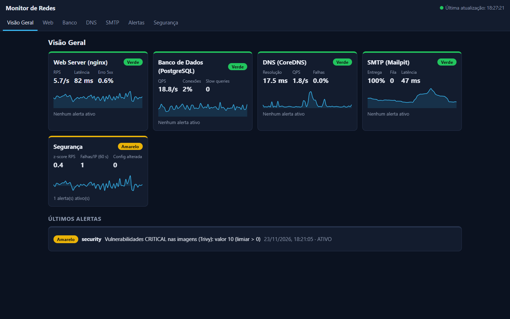

# Plataforma de Monitoramento para DevOps

Trabalho final de Redes de Computadores (IDP). Monitora Web Server (nginx), Banco de Dados (PostgreSQL), DNS (CoreDNS) e SMTP (Mailpit), com API REST, dashboards, alertas e monitoramentos de segurança.



*Painel, Visão Geral, em operação normal. O card de Segurança fica amarelo porque as imagens públicas usadas têm CVEs CRITICAL conhecidos.*

Para subir tudo (Windows 11 com Docker Desktop e WSL2):

```powershell
docker compose up -d --build
```

Depois abra o painel em http://localhost:8000 e o Mailpit (e-mails de alerta) em http://localhost:8025.

## Índice da documentação

| Documento | Para quê |
|---|---|
| [docs/INSTALACAO.md](docs/INSTALACAO.md) | Instalar do zero no Windows (WSL2, Docker Desktop, Git), subir, Trivy, testes e solução de problemas |
| [docs/ARQUITETURA.md](docs/ARQUITETURA.md) | Componentes, rede e portas, fluxo do dado, decisões e limitações (inclui o diagrama `docs/img/fig00_arquitetura.png`) |
| [docs/RUNBOOKS.md](docs/RUNBOOKS.md) | Como verificar, diagnosticar e recuperar cada serviço (web, banco, DNS, SMTP, monitor) |
| [docs/PLAYBOOKS.md](docs/PLAYBOOKS.md) | O que fazer em cada tipo de incidente (queda, latência, erros, DDoS, brute force, configuração, CVE) |
| [docs/ROTEIRO_APRESENTACAO.md](docs/ROTEIRO_APRESENTACAO.md) | Roteiro de 10 a 12 minutos, demo ao vivo e plano B |
| [docs/ROTEIRO_VIDEO.md](docs/ROTEIRO_VIDEO.md) | Roteiro do vídeo explicativo (5 a 8 minutos), cena por cena |
| [docs/TESTES.md](docs/TESTES.md) | Casos de teste, resultados e evidências |
| [docs/RELATORIO_PROCESSO.md](docs/RELATORIO_PROCESSO.md) | Relatório de cada fase: decisões, conceitos de redes, comandos, perguntas da banca e problemas |
| [docs/img/LEGENDAS.md](docs/img/LEGENDAS.md) | Legendas das figuras do artigo |
| [CLAUDE.md](CLAUDE.md) | Regras de trabalho do projeto |

## Como rodar

| O que | Endereço |
|---|---|
| Monitor (API e front) | http://localhost:8000 |
| Swagger da API | http://localhost:8000/docs |
| Site nginx | http://localhost:8081 (`/admin` usa `admin` / `admin123`) |
| Mailpit (e-mails) | http://localhost:8025 |
| Métricas do CoreDNS | http://localhost:9153/metrics |
| DNS (UDP/TCP) | `localhost:1053` |
| PostgreSQL | `localhost:5433` (usuário `app`, senha `app123`) |

Parar tudo: `docker compose down` (use `-v` para apagar também os dados).

## Alertas

As regras ficam em [monitor/alerts.yaml](monitor/alerts.yaml) (serviço, métrica, operador, limiar amarelo e vermelho, ciclos). Depois de editar, rode `docker compose up -d --build monitor`. Níveis: Verde (ok), Amarelo (atenção), Vermelho (crítico). Cada mudança de nível gera um e-mail (`[ATENÇÃO]`, `[CRÍTICO]` ou `[RECUPERADO]`), por padrão no Mailpit (http://localhost:8025).

### Enviar alertas por um SMTP real (opcional)

Crie um arquivo `.env` na raiz (está no `.gitignore`, nunca vai para o repositório). Use [.env.example](.env.example) como modelo:

| Variável | Significado | Padrão |
|---|---|---|
| `SMTP_HOST` | servidor SMTP | `mailpit` |
| `SMTP_PORT` | porta | `1025` |
| `SMTP_USER` / `SMTP_PASS` | credenciais (vazias = sem autenticação) | vazio |
| `SMTP_TLS` | `none`, `starttls` (porta 587) ou `ssl` (porta 465) | `none` |
| `ALERT_TO` | destinatário | `ops@lab.local` |
| `ALERT_FROM` | remetente | `alertas@lab.local` |
| `DASHBOARD_URL` | link usado no corpo do e-mail | `http://localhost:8000` |

As sondas de monitoramento do SMTP continuam sempre no Mailpit, independente dessas variáveis.

## Segurança (aba Segurança do dashboard)

| Monitoramento | Como funciona | Alerta |
|---|---|---|
| Anomalia de tráfego (DDoS) | z-score do RPS contra baseline de 10 min + top 5 IPs | amarelo z > 3, vermelho z > 6 ou RPS > 10x a baseline |
| Brute force | falhas de login por IP e por conta em 60 s (401 no `/admin`, "password authentication failed" no Postgres) | amarelo > 10, vermelho > 30 falhas do mesmo IP |
| Alteração de configuração | SHA-256 dos arquivos de `services/` contra a baseline guardada | amarelo ao mudar 1 arquivo (botão "Aceitar nova baseline") |
| Vulnerabilidades | Trivy escaneia as imagens e o monitor lê o JSON | amarelo se houver CRITICAL |

Escanear as imagens (baixa o banco de CVEs na primeira vez, cerca de 140 MB):

```powershell
docker compose --profile scan run --rm trivy
```

Trocar o modo do gerador de tráfego ao vivo, sem rebuild (também há botões na aba Segurança):

```powershell
Invoke-RestMethod -Method Post http://localhost:8090/mode/pico         # ou normal, bruteforce
```

## Scripts de demonstração (PowerShell)

```powershell
.\scripts\demo_queda.ps1 postgres      # nginx, postgres, coredns ou mailpit
.\scripts\demo_ddos.ps1                # pico de tráfego por 60 s
.\scripts\demo_bruteforce.ps1          # brute force por 60 s
.\scripts\demo_config.ps1              # altera o nginx.conf, espera o alerta e desfaz
.\scripts\demo_reset.ps1               # volta tudo ao normal
.\scripts\preparar_apresentacao.ps1    # sobe tudo, espera ficar verde, limpa o histórico de alertas e abre o navegador
```

Se o PowerShell bloquear a execução: `powershell -ExecutionPolicy Bypass -File .\scripts\demo_ddos.ps1`.

## Testes e figuras

```powershell
pip install playwright pytest          # usa o Google Chrome instalado, sem baixar outro navegador
python -m pytest tests/e2e             # suíte E2E (leva alguns minutos: derruba serviços e simula ataques)
python scripts/capturar_prints.py      # gera as figuras em docs/img/
```

Casos de teste e resultados: [docs/TESTES.md](docs/TESTES.md). Legendas das figuras: [docs/img/LEGENDAS.md](docs/img/LEGENDAS.md).

## Status

- [x] Fase 1: infraestrutura, coletores, SQLite, API REST, loadgen modo normal
- [x] Fase 2: dashboard (Visão Geral, Web, Banco, DNS, SMTP, Alertas) e motor de alertas com e-mail
- [x] Fase 3: segurança (DDoS, brute force, alteração de config, vulnerabilidades), scripts de demo, testes E2E e figuras
