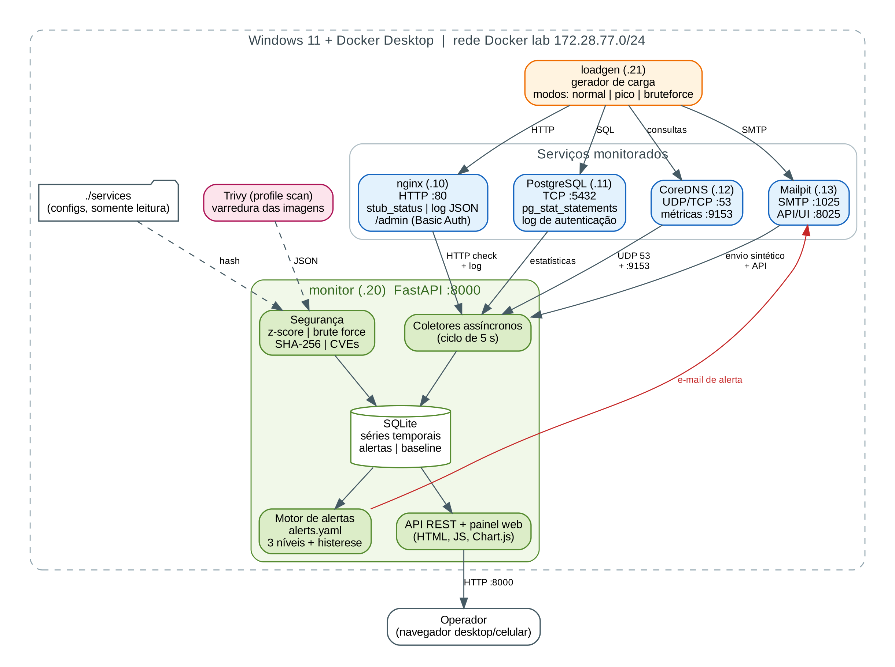

# Arquitetura da plataforma

Plataforma de monitoramento para DevOps que observa quatro serviços de rede (Web, Banco de Dados, DNS e SMTP), calcula métricas a cada 5 segundos, mostra tudo em um painel web, dispara alertas em 3 níveis com e-mail e vigia a segurança (tráfego anormal, brute force, alteração de configuração e vulnerabilidades conhecidas).



*Figura 0. Diagrama de arquitetura (arquivo `docs/img/fig00_arquitetura.png`).*

## 1. Visão geral em texto

```
                      Windows 11 + Docker Desktop (WSL2)
  Navegador ------------------------------------------------------------------------+
  (você, na apresentação)                                                            |
     |  http://localhost:8000 (painel)          http://localhost:8025 (Mailpit)      |
     v                                                                               |
 +-------------------------- rede Docker "lab" 172.28.77.0/24 -------------------+  |
 |                                                                                |  |
 |  SERVIÇOS MONITORADOS                          GERADOR DE TRÁFEGO              |  |
 |  +---------+ +-----------+ +---------+ +--------+     +----------------+      |  |
 |  | nginx   | | postgres  | | coredns | |mailpit |     | loadgen  .21   |      |  |
 |  | .10 :80 | | .11 :5432 | | .12 :53 | | .13    |<----| normal | pico  |      |  |
 |  | log JSON| | pg_stat_  | | UDP/TCP | | :1025  |     | bruteforce     |      |  |
 |  | stub_   | | statements| | :9153   | | :8025  |     | API :8090      |      |  |
 |  | status  | | log lento | | metrics | | API    |     +----------------+      |  |
 |  +----+----+ +-----+-----+ +----+----+ +---+----+                             |  |
 |       | HTTP + log   | SQL+log    | UDP 53   | SMTP+API                       |  |
 |       v              v            v          v                                |  |
 |  +---------------------------------------------------------------+            |  |
 |  | monitor .20 (Python 3.12 + FastAPI)                :8000      |<-----------+--+
 |  |  coletores async (5 s): web | postgres | dns | smtp | seguranca|            |
 |  |  motor de alertas  --> e-mail (SMTP) --> Mailpit              |            |
 |  |  SQLite: metrics, alerts, config_baseline                      |            |
 |  |  API REST + front-end estático (HTML, CSS, JS, Chart.js)       |            |
 |  +----------+-----------------+----------------+-----------------+            |
 |             | ./services (ro) | docker.sock    | volume trivy-results (ro)    |
 |             v                 v (ro)           v                              |
 |   hash SHA-256 das configs   CPU/memória do   JSON do scan de CVEs             |
 |                              Postgres e log   (container trivy, profile scan)  |
 +--------------------------------------------------------------------------------+
```

## 2. Componentes

| Componente | Imagem | Função | O que o monitor lê dele |
|---|---|---|---|
| **nginx** | `nginx:1.27-alpine` | Site de teste, `stub_status`, `/admin` com `auth_basic`, log de acesso em JSON | HTTP check, `stub_status`, access log (volume compartilhado) |
| **postgres** | `postgres:16` | Banco com `pg_stat_statements` e log de queries lentas (> 200 ms) | Views de estatística (SQL), CPU/memória pelo `docker.sock`, log de falhas de login |
| **coredns** | `coredns/coredns:1.11.3` | DNS autoritativo da zona `lab.local`, métricas Prometheus na 9153 | Consulta DNS real (UDP 53) e `/metrics` |
| **mailpit** | `axllent/mailpit:v1.21` | Servidor SMTP de laboratório (porta 1025) com interface web (8025) que recebe os e-mails de alerta | Banner SMTP, API HTTP para confirmar entrega |
| **monitor** | build local (`python:3.12-slim`) | Coleta, armazena, alerta e serve a API e o painel | (é o centro do sistema) |
| **loadgen** | build local (`python:3.12-slim`) | Gera tráfego realista e simula ataques, modo trocável ao vivo | n/a |
| **trivy** | `aquasec/trivy:0.58.1` | Escaneia as imagens e grava JSON (só roda com o profile `scan`) | JSON por serviço |

## 3. Rede, endereços e portas

Rede Docker `lab`, faixa fixa `172.28.77.0/24` (gateway `172.28.77.1`, que é o host). IPs fixos permitem que a zona DNS `lab.local` aponte para endereços reais.

| Container | IP interno | Porta interna | Porta no host (Windows) | Protocolo |
|---|---|---|---|---|
| nginx | 172.28.77.10 | 80 | **8081** | HTTP (TCP) |
| postgres | 172.28.77.11 | 5432 | **5433** | PostgreSQL (TCP) |
| coredns | 172.28.77.12 | 53, 9153 | **1053** (UDP e TCP), **9153** | DNS (UDP/TCP), HTTP |
| mailpit | 172.28.77.13 | 1025, 8025 | **1025**, **8025** | SMTP (TCP), HTTP |
| monitor | 172.28.77.20 | 8000 | **8000** | HTTP |
| loadgen | 172.28.77.21 | 8090 | **8090** | HTTP (controle) |

As portas do host foram escolhidas para não colidir com serviços do Windows (a porta 53 costuma estar ocupada, por isso o DNS fica em 1053).

Volumes: `nginx-logs` (access log JSON), `pgdata` (dados do Postgres), `monitor-data` (SQLite), `trivy-results` e `trivy-cache`.

O monitor monta: `./services` em `/config` (somente leitura, para o hash), `/var/run/docker.sock` (somente leitura, para CPU/memória e logs do Postgres), `nginx-logs` e `trivy-results` (somente leitura).

Fuso horário: todos os containers usam `TZ=America/Sao_Paulo`, e o painel formata as datas no mesmo fuso, então o horário do painel, dos logs e dos e-mails coincide.

## 4. Fluxo do dado

```
serviço --> coletor (a cada 5 s) --> SQLite (metrics) --+--> motor de alertas --> SQLite (alerts) --> e-mail (SMTP 1025) --> Mailpit
                                                        |
                                                        +--> API REST --> navegador (fetch a cada 5 s) --> Chart.js
```

1. **Coleta.** Cinco coletores assíncronos (`asyncio`) rodam em paralelo a cada 5 s: `web`, `postgres` (serviço `db`), `dns_check`, `smtp_check` e `seguranca`. Cada um devolve linhas `(métrica, valor, rótulos)`. Se um coletor falhar, só o serviço dele é marcado como fora do ar (`up = 0`).
2. **Armazenamento.** Uma tabela de série temporal `metrics(ts, service, metric, value, labels)` em SQLite (modo WAL, retenção de 24 h).
3. **Alertas.** Logo depois de gravar, o motor lê o SQLite, agrega cada regra do `alerts.yaml` (último valor, média, soma ou p95 de uma janela), decide o nível (verde, amarelo ou vermelho), aplica a histerese (N ciclos seguidos) e, ao mudar de estado, grava o incidente na tabela `alerts` e envia o e-mail.
4. **Painel.** O navegador consulta a API REST a cada 5 s e redesenha os gráficos.

### Métricas por serviço

| Serviço | Como é medido | Métricas |
|---|---|---|
| Web | HTTP check, `stub_status`, access log JSON | `up`, `latency_ms`, `rps`, `active_connections`, `requests_by_code`, `error_rate_4xx`, `error_rate_5xx` |
| Banco | SQL em `pg_stat_*`, API do Docker | `up`, `qps`, `rollbacks_per_s`, `connections`, `connections_percent`, `cpu_percent`, `memory_mb`, `io_bytes_per_s`, `db_size_bytes`, `db_growth_mb_per_h`, `db_growth_gb_per_day`, `slow_queries` |
| DNS | Consulta UDP 53 e `/metrics` do CoreDNS | `up`, `resolve_ms`, `qps`, `failure_rate`, `nxdomain_rate` |
| SMTP | Sondas por uma fila interna e API do Mailpit | `up`, `queue_size`, `send_latency_ms`, `delivery_rate`, `error_rate`, `volume_per_min` |
| Segurança | Access log, log do Postgres, hash dos arquivos, JSON do Trivy | `rps_zscore`, `rps_ratio`, `max_auth_failures_per_ip`, `config_changed_files`, `vulns_critical_total` e outras |

### Banco de dados do monitor (SQLite)

| Tabela | Conteúdo |
|---|---|
| `metrics` | uma linha por medição (`ts`, `service`, `metric`, `value`, `labels` em JSON) |
| `alerts` | um incidente por linha: regra, serviço, nível atual e pior nível, abertura, resolução e lista de eventos |
| `config_baseline` | SHA-256 e conteúdo de cada arquivo de `services/` (baseline) |

### API REST

| Endpoint | Uso |
|---|---|
| `GET /api/health` | saúde do próprio monitor |
| `GET /api/services` | estado e último valor de cada métrica, por serviço |
| `GET /api/metrics?service=&metric=&since=` | séries temporais (`since` aceita `5m`, `1h`...) |
| `GET /api/alerts?service=&level=&active=` | histórico de incidentes |
| `GET /api/alert-rules` | regras com nível e valor atual |
| `GET /api/security` | painel de segurança |
| `POST /api/security/config/accept` | aceita a nova baseline de configuração |
| `GET /api/loadgen`, `POST /api/loadgen/{modo}` | consulta e troca do modo do gerador de tráfego |
| `GET /docs` | documentação interativa (Swagger) |

## 5. Decisões de projeto

| Decisão | Motivo | Alternativa descartada |
|---|---|---|
| SQLite com uma tabela de série temporal | Simples, sem servidor, suficiente para a escala | InfluxDB ou Prometheus (mais peças para explicar) |
| `asyncio` nos coletores | Os coletores esperam rede (I/O); em paralelo o ciclo dura o do mais lento | Threads ou processos |
| Taxas calculadas no coletor (RPS, QPS) | O painel só desenha; contadores viram taxa por diferença entre leituras | Guardar o contador bruto |
| Regras de alerta em YAML | Legível e editável sem mexer em código | Regras no código Python |
| Histerese por número de ciclos | Evita alerta por um pico e evita "pisca-pisca" | Alertar na primeira leitura ruim |
| Painel sem framework (HTML, CSS, JS puro, Chart.js por CDN) | Sem build nem npm, fácil de explicar | React ou Vue |
| Log do nginx em JSON em volume compartilhado | Contar status e IPs sem regex | Ler o log do Docker |
| `real_ip` confiando só na rede interna | O IP do cliente vem do `X-Forwarded-For` sem permitir falsificação de fora | Confiar em qualquer origem |
| z-score com baseline que não absorve anomalias | O ataque não vira "normal" sozinho | Média simples |
| Trivy em container com profile `scan` | Não pesa no uso normal, não exige instalar nada | Instalar o Trivy no host |
| Docker Compose único | `docker compose up -d --build` sobe tudo | Kubernetes (exagero para o escopo) |

## 6. Limitações conhecidas

- **Escala.** SQLite e coletores num único processo atendem bem este laboratório (cinco coletores, poucos serviços), mas não um parque grande de servidores.
- **Retenção de 24 h.** Dados mais antigos são apagados. Para histórico longo seria preciso um banco de séries temporais.
- **Acesso ao `docker.sock`.** Mesmo em modo somente leitura, dá ao monitor visão ampla sobre o Docker. Em produção usaria um agente com permissões mínimas.
- **`real_ip` e o gateway do host.** A faixa confiável (`172.28.77.0/24`) inclui o gateway, então quem acessa o nginx pelo próprio computador chega como confiável. Em produção, confiar só no IP exato do balanceador.
- **Slow queries aproximadas.** A contagem usa a média de `pg_stat_statements` (200 ms), não cada execução individual (o log do Postgres traz cada uma).
- **Segredos de laboratório.** Senhas como `app123` e `admin123` estão no compose e no `htpasswd` para facilitar a demonstração. Em produção ficariam em um gerenciador de segredos.
- **Vulnerabilidades de imagens públicas.** O Trivy encontra CVEs reais nas imagens usadas (alguns CRITICAL), o que mantém o card de Segurança em amarelo. A mitigação é atualizar as imagens.
- **E-mail real não testado.** O envio por SMTP externo está documentado, mas só o Mailpit foi exercitado.
- **Propagação de arquivos no Windows.** O Docker Desktop pode demorar a refletir, dentro do container, uma alteração de arquivo feita no Windows (de 5 s até cerca de 80 s sob carga), o que atrasa a detecção de alteração de configuração.
